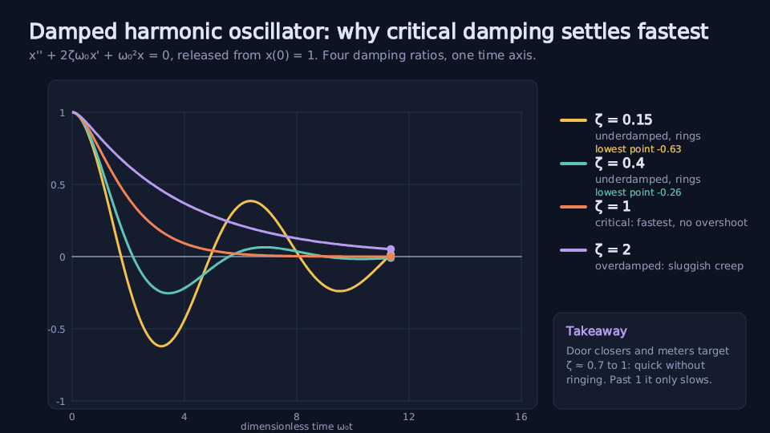
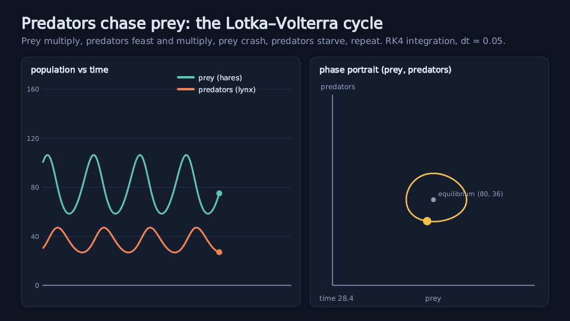
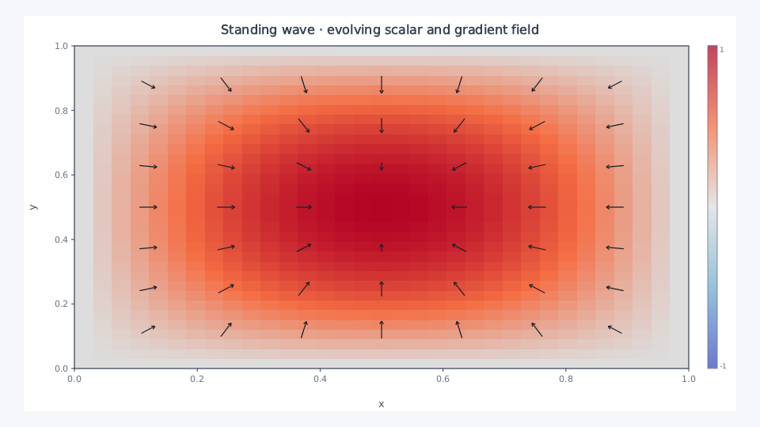

# lmvideo

Skia-powered plots, diagrams, image processing and video, driven by short lmscript programs. Every picture below links to an example you can run directly from the public repository.

## Install lmctl

Install the lmctl command-line tool, then autorun an example:

```bash
npm install -g @lmctl-ai/lmctl
lmctl autorun https://raw.githubusercontent.com/lmctl-ai/lmvideo/main/examples/damped-oscillator.lms
```

## Install lmvideo

v0.1.36 CPU binaries include Cycles for Linux x86_64/arm64, macOS x86_64/arm64 (13 or newer), and Windows x86_64 (10 or newer). Linux requires glibc2.35 or newer; each platform needs its standard tar utility. FFmpeg/ffprobe are user-supplied for video output. The release page includes `SHA256SUMS` and the required license and third-party notice files.

```lms
program = _lmcode_ cli="lmvideo" install="github:lmctl-ai/lmvideo@latest";
// Canvas, Plot, Panel, image, and video calls go here.
end _lmcode_
```

## Examples

| Example | Preview | Run |
| --- | --- | --- |
| Damped oscillator |  | `lmctl autorun https://raw.githubusercontent.com/lmctl-ai/lmvideo/main/examples/damped-oscillator.lms` |
| Lotka–Volterra |  | `lmctl autorun https://raw.githubusercontent.com/lmctl-ai/lmvideo/main/examples/lotka-volterra.lms` |
| Confusion matrix |  | `lmctl autorun https://raw.githubusercontent.com/lmctl-ai/lmvideo/main/examples/confusion-matrix.lms` |
| Order approval flowchart |  | `lmctl autorun https://raw.githubusercontent.com/lmctl-ai/lmvideo/main/examples/flowchart-order-approval.lms` |
| Standing-wave field |  | `lmctl autorun https://raw.githubusercontent.com/lmctl-ai/lmvideo/main/examples/standing-wave-field.lms` |
| Vector outputs |  | `lmctl autorun https://raw.githubusercontent.com/lmctl-ai/lmvideo/main/examples/vector-outputs.lms` |

The curated [example manifest](examples/manifest.json) locks selected example and picture hashes. [Render Cycles](docs/book/render-cycles.md) explains the CPU rendering mode and its limits.

The full example set includes APIs newer than the current v0.1.35 release. The six featured examples above pass against that release; publish the remaining examples only after the matching runtime update is available and the public-content checks pass.

## License and support

The README, docs, pictures, and examples are MIT-licensed under [LICENSE-examples](LICENSE-examples). Binary releases use [LICENSE](LICENSE); third-party components retain their own licenses and notices in [THIRD_PARTY_NOTICES.md](THIRD_PARTY_NOTICES.md) and `docs/third-party-licenses/`.

Releases up to and including v0.1.35 were published under the MIT License (see the LICENSE asset of that release). Releases after v0.1.35 are published under the Lattice Systems Binary License 1.0 (this file).

Implementation sources and their development history are maintained separately from this public content repository. Please use GitHub Issues for questions. Documentation and example pull requests are welcome; this repository does not accept implementation-source pull requests.
