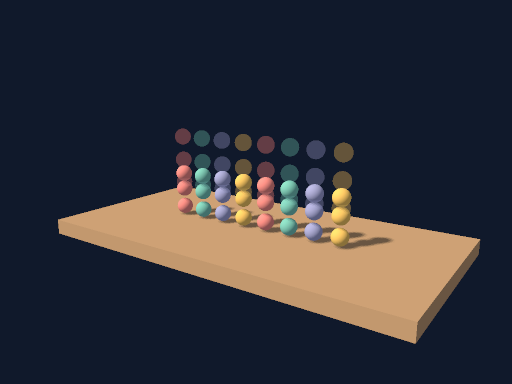
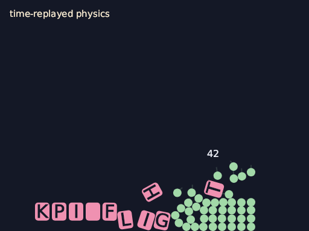
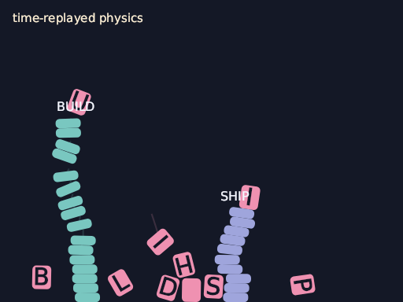
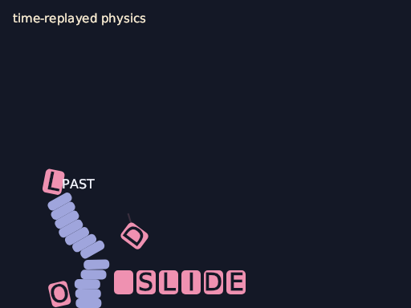
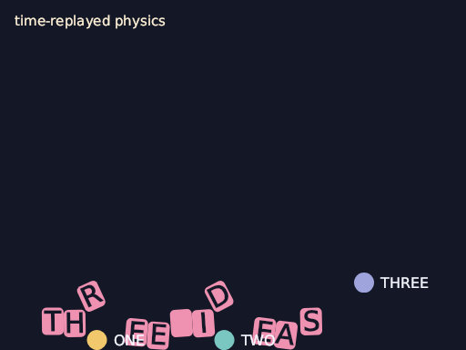

# lmvideo

Plots, diagrams, image processing, rigid-body motion and video from short
LMScript programs. Each preview links to its runnable source.

## Install

The **[v0.1.124 release](https://github.com/lmctl-ai/lmvideo/releases/tag/v0.1.124)**
contains the current lmcode host and physics API. It has binaries for five
platforms: **Linux x86_64 and arm64, macOS x86_64 and arm64 (13+), and
Windows x86_64 (10+)**. Linux requires glibc 2.35+. Video output requires
user-supplied FFmpeg/ffprobe; each platform needs its standard tar utility.
Release assets include the five native binaries, `SHA256SUMS`,
`RELEASE-MANIFEST.json`, `FROZEN-CANDIDATE.json`, `PROVENANCE.jsonl`, `LICENSE`,
`THIRD_PARTY_NOTICES.md`, and `lmvideo-third-party-licenses.tar.gz`. See the
[release qualification runbook](docs/release-pipeline.md) for the private-draft
to public-qualification promotion pipeline.

```sh
npm install -g @lmctl-ai/lmctl@0.2.460
lmctl autorun https://raw.githubusercontent.com/lmctl-ai/lmvideo/main/examples/physics/plinko.lms
```

Examples explicitly select `github:lmctl-ai/lmvideo@v0.1.124` for reproducible
runs. They use `run_lmcode()` and
check `r.ok`; bytecode stays internal. CAD examples select
`github:lmctl-ai/lmcad@v0.1.5`, the current migrated CAD release line.
Read downloaded scripts before running them and use a fresh output directory.

## Physics in motion


CPU rigid bodies turn pastel geometry and presentation content into motion.
These six studies use fixed forward simulation and explicitly labeled periodic
replay. Their posters show action frames, with depth-tested afterimages in the
Plinko and ballpit studies. [Run all 15 chapters](examples/physics/README.md)
or read [the physics API](docs/physics.md).

| Plinko | Ballpit | 42 ideas |
| --- | --- | --- |
| [](examples/physics/plinko.lms) | [](examples/physics/ballpit-impact.lms) | [](examples/physics/kpi-42.lms) |
| [](examples/physics/bar-stack.lms) | [](examples/physics/slide-tumble.lms) | [](examples/physics/bullet-container.lms) |

The [physics book catalog](examples/books.json) contains all 15 chapters, source
hashes, measured loop evidence and media. Earlier plots and diagrams remain
available in the [example manifest](examples/manifest.json).


## More examples

Run `lmscript examples/damped-oscillator.lms`, or explore the
[plots and diagrams](examples/manifest.json), [full book catalog](examples/books.json),
[physics API](docs/physics.md) and [CPU Cycles guide](docs/book/render-cycles.md).
The [physics example guide](examples/physics/README.md) explains the 15 studies.
The manual five-OS integration workflow tests actual release binaries.
The [compact SVG to PowerPoint example](examples/svg-compact-pptx.lms) renders
one validated SVG through lmvideo and embeds the resulting PNG in a slide;
see the [dry-run and raster-size notes](docs/svg-compact-pptx.md).

## License and support

Examples, documentation and pictures are MIT-licensed under
[LICENSE-examples](LICENSE-examples). Binary releases use the Lattice Systems
Binary License in [LICENSE](LICENSE); dependencies retain their notices in
[THIRD_PARTY_NOTICES.md](THIRD_PARTY_NOTICES.md) and [third-party licences](docs/third-party-licenses/).
Releases through v0.1.35 used MIT; later binary releases use the separate binary licence.
Please use [GitHub Issues](https://github.com/lmctl-ai/lmvideo/issues) for questions.
This public repository accepts content contributions; implementation sources
are maintained separately.
