# lmvideo

lmvideo is an experimental C++ library and lmscript host for deterministic raster drawing, SVG rendering, and short video output. The host owns the process, Skia surface, FFmpeg process, and output files; one `_dsl_` chunk configures the run and performs its frame and attribute loops.

The project is licensed under the MIT License. See [THIRD_PARTY_NOTICES.md](THIRD_PARTY_NOTICES.md) for the bundled DejaVu Sans font, the downloaded Skia pack, external FFmpeg, and the separately maintained DSL runtime header.

## Requirements

- Linux (x86-64, arm64) or macOS (arm64, x86-64) with a C++17 compiler, `make`, Python 3, `curl`, `unzip`, `ffmpeg` and `ffprobe` (FFmpeg is only needed to write video; images do not use it).
- Node.js and npm for the released compiler package, with released lmscript **0.2.347 or newer** on `PATH` (set `LMSCRIPT_BIN` for another executable).
- A network connection for the pinned JetBrains Skia archive of your platform, or a local copy supplied through `LMVIDEO_SKIA_ZIP`.

The build downloads `Skia-m144-e2e6623374-4-<os>-Release-<arch>.zip`, verifies the SHA-256 in [scripts/skia.lock](scripts/skia.lock), and unpacks it under the ignored `third_party/` directory. Skia is not vendored in this repository.

## Install and run

Every push to `main` is released automatically (executables `lmvideo-linux-x64`, `-linux-arm64`, `-macos-arm64`, `-macos-x64`; the Linux ones are fully static). lmscript installs the right one on first use:

```sh
npm install -g @lmctl-ai/lmctl
lmctl autorun https://raw.githubusercontent.com/lmctl-ai/lmvideo/main/examples/video.lms   # writes images/video.mp4
```

Video encoding runs the `ffmpeg` on your `PATH` as a separate process; see [durable-memory/06-ffmpeg-in-process-feasibility.md](durable-memory/06-ffmpeg-in-process-feasibility.md) for the in-process option.

## Gallery

Animated 2D physics and maths diagrams drawn with Skia and encoded to video. The reusable `Canvas.plot()` / `Plot` / `Series` API includes heatmaps, contours, vector fields, statistical chart kinds, date and symlog axes, error bands, and insets alongside lines, bars, and scatter; plots redraw on the current video frame and compose with low-level Canvas drawing. `Document` records a Canvas once and replays it to 1×–4× PNG, outlined-text SVG, PDF, and serialized Skia Picture; `PdfDocument` writes multi-page reports. `Canvas.panel()` adds explicit pack, grid, place, border, flow, and box managers for predictable multi-panel layouts, and the lmdraw-compatible diagram vocabulary (labeled shapes, anchored connectors, grids, sequence notation) adds retained flowcharts, trees, state machines, and timelines that animate per frame. Other ports and examples keep using the same Canvas primitives. For gnuplot-based charts, see [lmplot](https://github.com/lmctl-ai/lmplot). Captions link a still PNG and give the `lmctl autorun` command.

| **Damped oscillator** | **Kepler's second law** | **Lotka–Volterra** |
| --- | --- | --- |
| 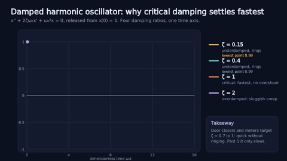 | 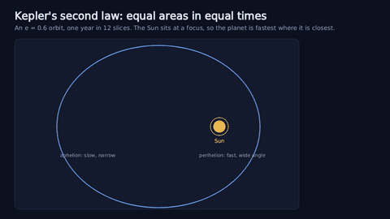 | 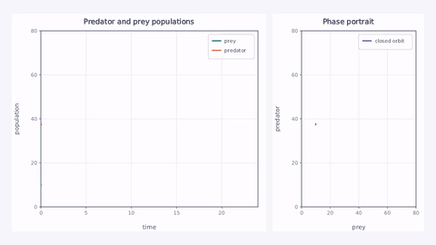 |
| Four damping regimes and their phase portraits for x'' + 2ζω x' + ω² x = 0. [MP4](docs/videos/damped-oscillator.mp4), [PNG](docs/images/damped-oscillator.png)<br>`lmctl autorun https://raw.githubusercontent.com/lmctl-ai/lmvideo/main/examples/damped-oscillator.lms` | Equal areas in equal times on an e = 0.6 orbit. [MP4](docs/videos/kepler-second-law.mp4), [PNG](docs/images/kepler-second-law.png)<br>`lmctl autorun https://raw.githubusercontent.com/lmctl-ai/lmvideo/main/examples/kepler-second-law.lms` | Predator and prey populations and their phase loop. [MP4](docs/videos/lotka-volterra.mp4), [PNG](docs/images/lotka-volterra.png)<br>`lmctl autorun https://raw.githubusercontent.com/lmctl-ai/lmvideo/main/examples/lotka-volterra.lms` |

| **Hohmann transfer** | **Carnot cycle** | **Lens ray diagram** |
| --- | --- | --- |
| 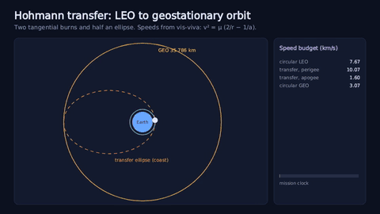 | 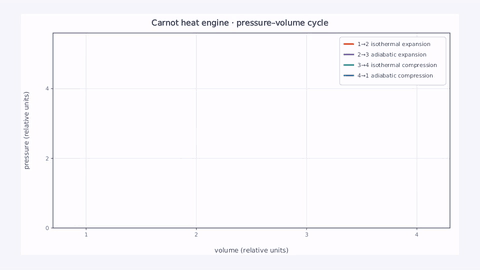 | 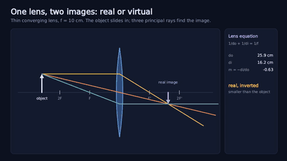 |
| Two burns move a spacecraft between circular orbits. [MP4](docs/videos/hohmann-transfer.mp4), [PNG](docs/images/hohmann-transfer.png)<br>`lmctl autorun https://raw.githubusercontent.com/lmctl-ai/lmvideo/main/examples/hohmann-transfer.lms` | The four strokes of the ideal heat engine on a P–V diagram. [MP4](docs/videos/carnot-cycle.mp4), [PNG](docs/images/carnot-cycle.png)<br>`lmctl autorun https://raw.githubusercontent.com/lmctl-ai/lmvideo/main/examples/carnot-cycle.lms` | Thin-lens image formation as the object moves. [MP4](docs/videos/lens-ray-diagram.mp4), [PNG](docs/images/lens-ray-diagram.png)<br>`lmctl autorun https://raw.githubusercontent.com/lmctl-ai/lmvideo/main/examples/lens-ray-diagram.lms` |

| **RC low-pass filter** | **Hydrogen spectrum** | **Ellipse geometry** |
| --- | --- | --- |
| 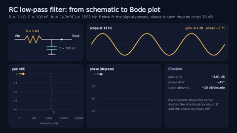 | 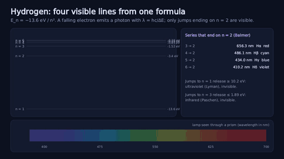 | 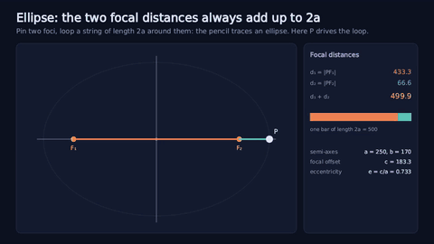 |
| Step response and Bode magnitude of a first-order filter. [MP4](docs/videos/rc-lowpass.mp4), [PNG](docs/images/rc-lowpass.png)<br>`lmctl autorun https://raw.githubusercontent.com/lmctl-ai/lmvideo/main/examples/rc-lowpass.lms` | Bohr levels and the Balmer series lines. [MP4](docs/videos/hydrogen-spectrum.mp4), [PNG](docs/images/hydrogen-spectrum.png)<br>`lmctl autorun https://raw.githubusercontent.com/lmctl-ai/lmvideo/main/examples/hydrogen-spectrum.lms` | Foci, the constant distance sum and the string construction. [MP4](docs/videos/geometry-ellipse.mp4), [PNG](docs/images/geometry-ellipse.png)<br>`lmctl autorun https://raw.githubusercontent.com/lmctl-ai/lmvideo/main/examples/geometry-ellipse.lms` |

| **Relativity · Lorentz factor** | **Quarterly revenue** | **Sensor calibration** |
| --- | --- | --- |
| 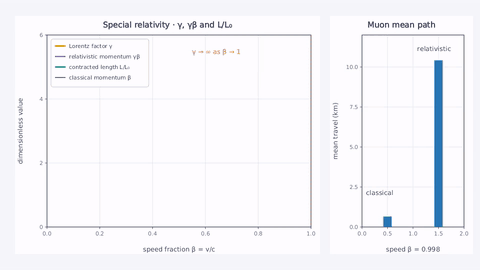 | 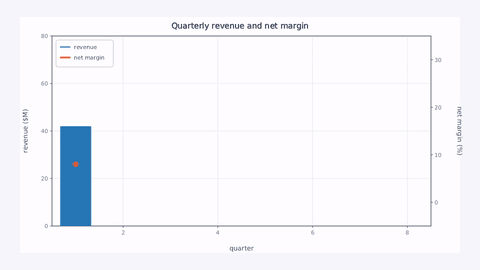 | 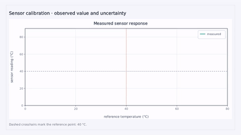 |
| Lorentz factor, momentum and length contraction as speed approaches light speed. [PNG](docs/images/relativity-lorentz.png)<br>`lmctl autorun https://raw.githubusercontent.com/lmctl-ai/lmvideo/main/examples/relativity-lorentz.lms` | Revenue bars and net-margin steps on twin Y axes. [PNG](docs/images/quarterly-revenue.png)<br>`lmctl autorun https://raw.githubusercontent.com/lmctl-ai/lmvideo/main/examples/quarterly-revenue.lms` | Calibration observations with uncertainty bars and reference lines. [PNG](docs/images/sensor-calibration.png)<br>`lmctl autorun https://raw.githubusercontent.com/lmctl-ai/lmvideo/main/examples/sensor-calibration.lms` |

| **Forecast area** | **Waveform sampling** | |
| --- | --- | --- |
| 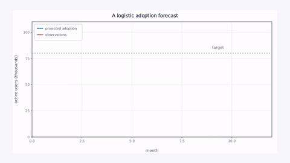 | 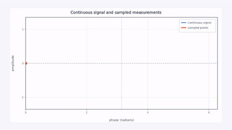 | |
| Logistic adoption forecast with observations and target. [PNG](docs/images/forecast-area.png)<br>`lmctl autorun https://raw.githubusercontent.com/lmctl-ai/lmvideo/main/examples/forecast-area.lms` | Continuous waveform compared with discrete samples. [PNG](docs/images/waveform-sampling.png)<br>`lmctl autorun https://raw.githubusercontent.com/lmctl-ai/lmvideo/main/examples/waveform-sampling.lms` | |

| **2×2 plot dashboard** | **Layout workbench** | |
| --- | --- | --- |
| 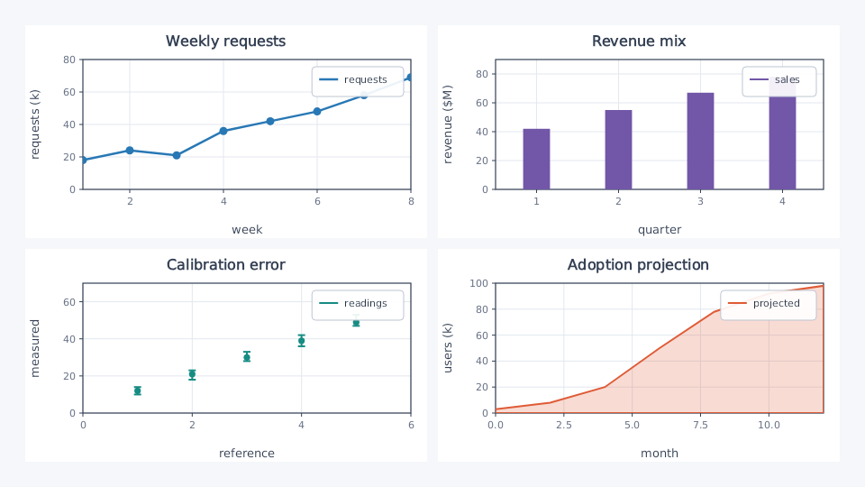 | 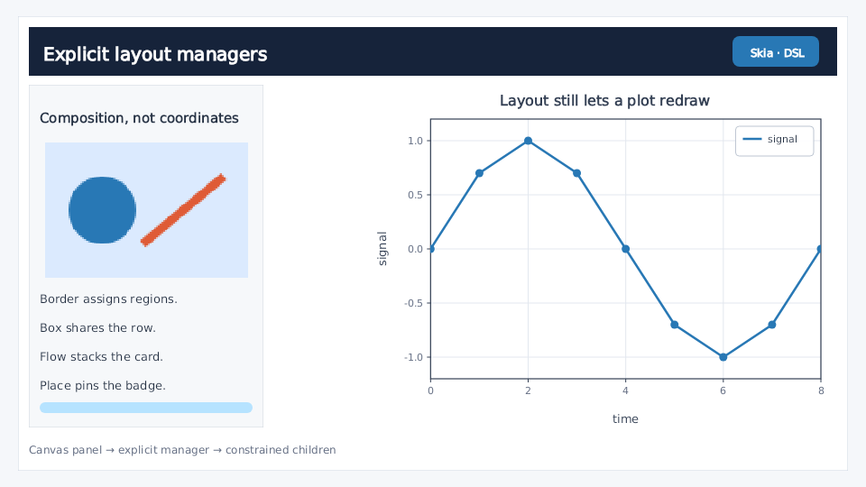 | |
| Four charts arranged by weighted grid cells. [PNG](docs/images/dashboard-grid.png)<br>`lmctl autorun https://raw.githubusercontent.com/lmctl-ai/lmvideo/main/examples/dashboard-grid.lms` | Border, box, flow and place managers compose plots, text, shapes, and an offscreen image. [PNG](docs/images/layout-workbench.png)<br>`lmctl autorun https://raw.githubusercontent.com/lmctl-ai/lmvideo/main/examples/layout-workbench.lms` | |

| **ROC AUC** | **Precision–recall** | **Confusion matrix** |
| --- | --- | --- |
| 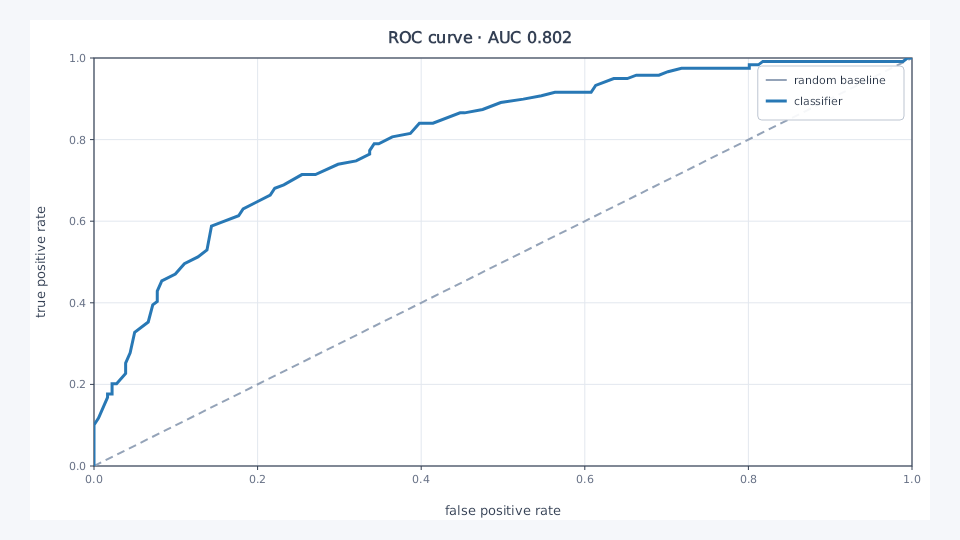 | 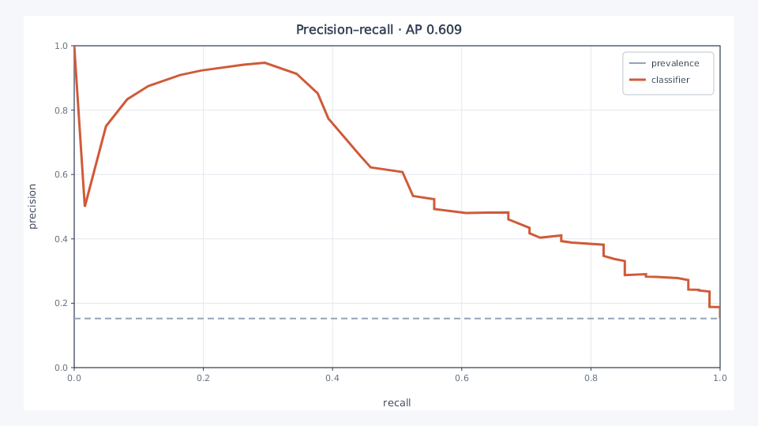 | 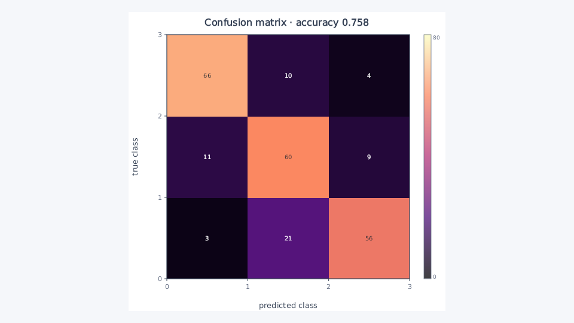 |
| Deterministic binary classifier sweep with AUC. [PNG](docs/images/roc-auc.png)<br>`lmctl autorun https://raw.githubusercontent.com/lmctl-ai/lmvideo/main/examples/roc-auc.lms` | The same imbalanced score sample used to compute average precision. [PNG](docs/images/pr-average-precision.png)<br>`lmctl autorun https://raw.githubusercontent.com/lmctl-ai/lmvideo/main/examples/pr-average-precision.lms` | Three-class counts with contrast-aware cell labels. [PNG](docs/images/confusion-matrix.png)<br>`lmctl autorun https://raw.githubusercontent.com/lmctl-ai/lmvideo/main/examples/confusion-matrix.lms` |

| **Poisson contours** | **Cavity quiver** | **Symlog outlier** |
| --- | --- | --- |
| 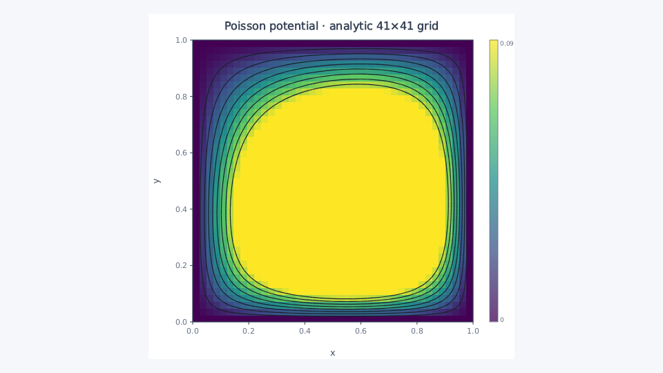 | 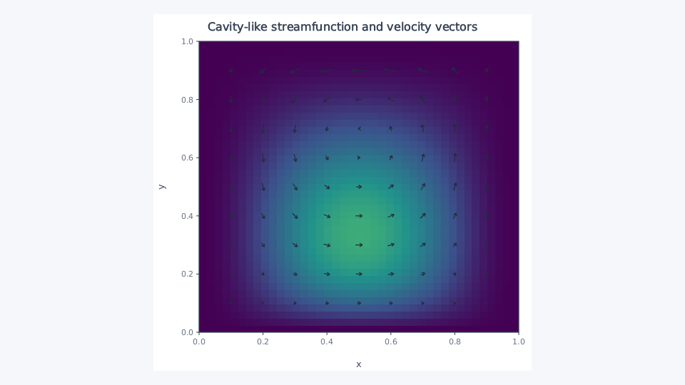 | 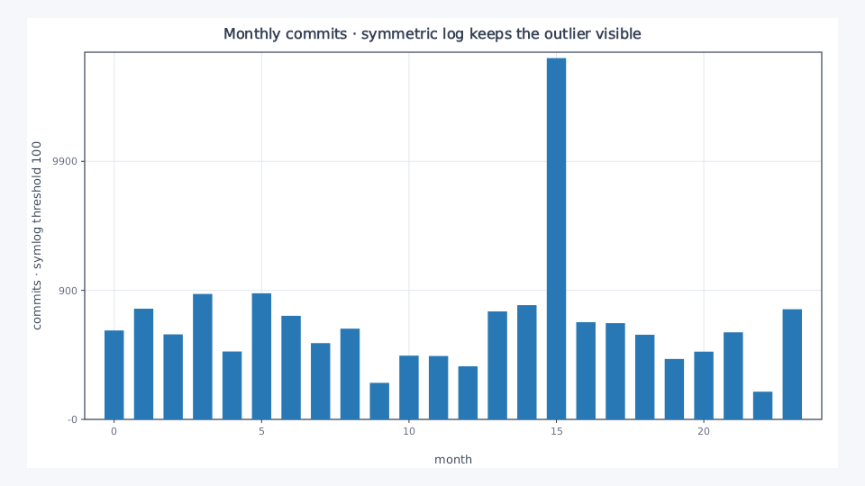 |
| Analytic potential heatmap with marching-squares contours. [PNG](docs/images/poisson-contours.png)<br>`lmctl autorun https://raw.githubusercontent.com/lmctl-ai/lmvideo/main/examples/poisson-contours.lms` | Streamfunction heatmap with velocity arrows. [PNG](docs/images/cavity-quiver.png)<br>`lmctl autorun https://raw.githubusercontent.com/lmctl-ai/lmvideo/main/examples/cavity-quiver.lms` | Symmetric-log scaling keeps ordinary months visible beside a 63,000 outlier. [PNG](docs/images/symlog-outlier.png)<br>`lmctl autorun https://raw.githubusercontent.com/lmctl-ai/lmvideo/main/examples/symlog-outlier.lms` |

| **Residual scatter** | **Chart kinds workbench** | **Standing wave field** |
| --- | --- | --- |
| 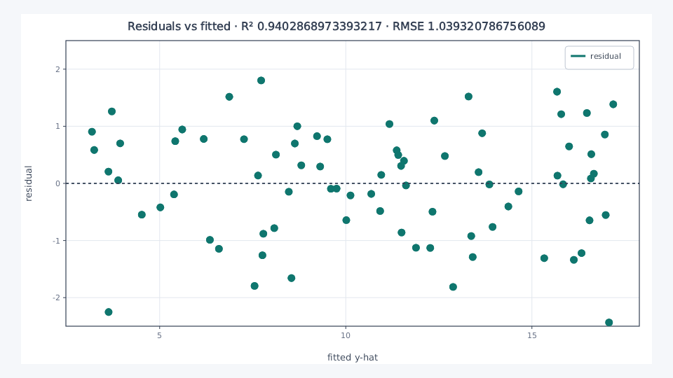 | 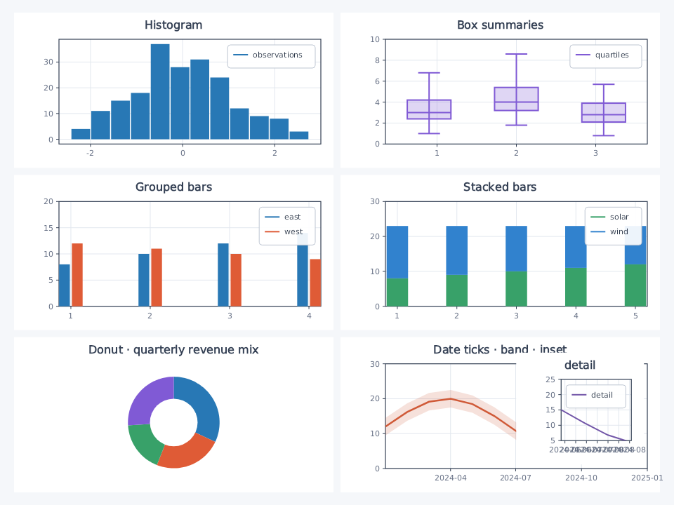 | 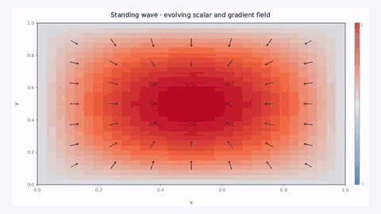 |
| Heteroscedastic OLS residuals around the zero reference. [PNG](docs/images/residual-scatter.png)<br>`lmctl autorun https://raw.githubusercontent.com/lmctl-ai/lmvideo/main/examples/residual-scatter.lms` | Histogram, box plot, grouped and stacked bars, donut, date axis, band, and inset. [PNG](docs/images/chart-kinds-workbench.png)<br>`lmctl autorun https://raw.githubusercontent.com/lmctl-ai/lmvideo/main/examples/chart-kinds-workbench.lms` | A heatmap and gradient vector field over 60 frames. [MP4](docs/videos/standing-wave-field.mp4), [PNG](docs/images/standing-wave-field.png)<br>`lmctl autorun https://raw.githubusercontent.com/lmctl-ai/lmvideo/main/examples/standing-wave-field.lms` |

`Canvas.box()` / `diamond()` / `cylinder()` / `note()` / `cluster()` draw labeled diagram shapes with named anchors (`n s e w ne nw se sw c`); `Canvas.connector()` routes edges between points or shape anchors (`straight`, `elbow`, `curve`; arrow/dot/diamond markers; dash lists; labels at `t` along the path); `Canvas.grid()` covers an extent with anchor-cell shapes; `lifeline()` / `message()` / `activation()` / `self_message()` draw sequence notation. The vocabulary mirrors [lmdraw](https://github.com/lmctl-ai/lmdraw) 0.2.6, so a diagram script ports between hosts by changing little. Retained nodes redraw in creation order on `canvas.draw_diagram()`, update per frame for animation, and compose with `Canvas.panel()` layouts: a diagram shape used as a layout child receives its bounds from the layout pass, and connector anchors given as `(shape, anchor)` resolve those bounds when `draw_diagram()` runs.

| **Order approval flowchart** | **ETL pipeline** | **OAuth refresh sequence** |
| --- | --- | --- |
| 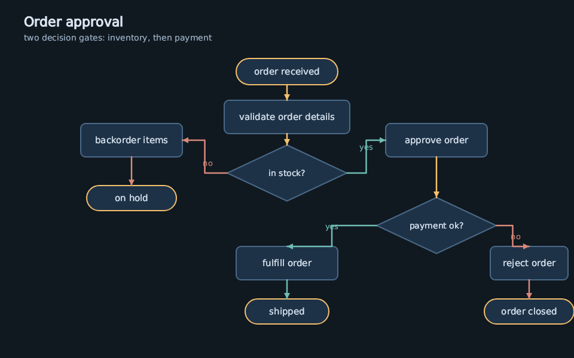 | 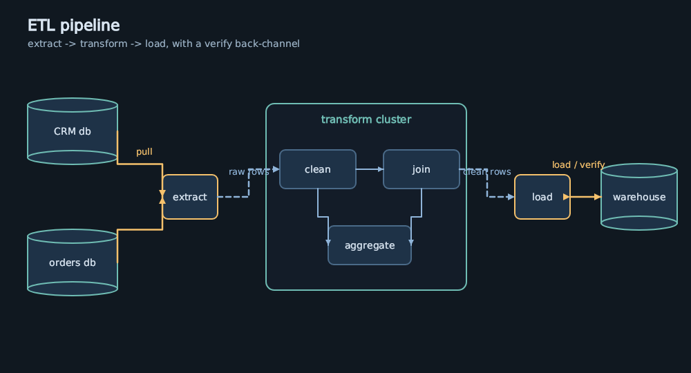 | 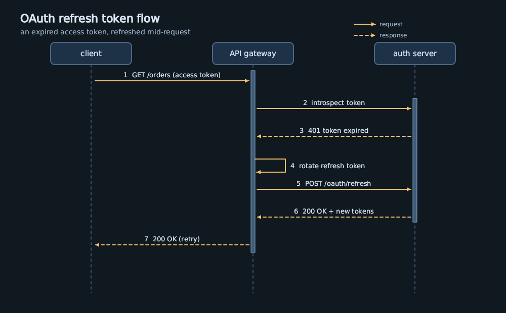 |
| Two decision gates: inventory, then payment. [PNG](docs/images/flowchart-order-approval.png)<br>`lmctl autorun https://raw.githubusercontent.com/lmctl-ai/lmvideo/main/examples/flowchart-order-approval.lms` | Extract -> transform -> load, with a verify back-channel. [PNG](docs/images/etl-pipeline.png)<br>`lmctl autorun https://raw.githubusercontent.com/lmctl-ai/lmvideo/main/examples/etl-pipeline.lms` | An expired access token, refreshed mid-request. [PNG](docs/images/sequence-oauth-refresh.png)<br>`lmctl autorun https://raw.githubusercontent.com/lmctl-ai/lmvideo/main/examples/sequence-oauth-refresh.lms` |

| **State machines** | **Org chart grid** | **Loan decision tree** |
| --- | --- | --- |
| 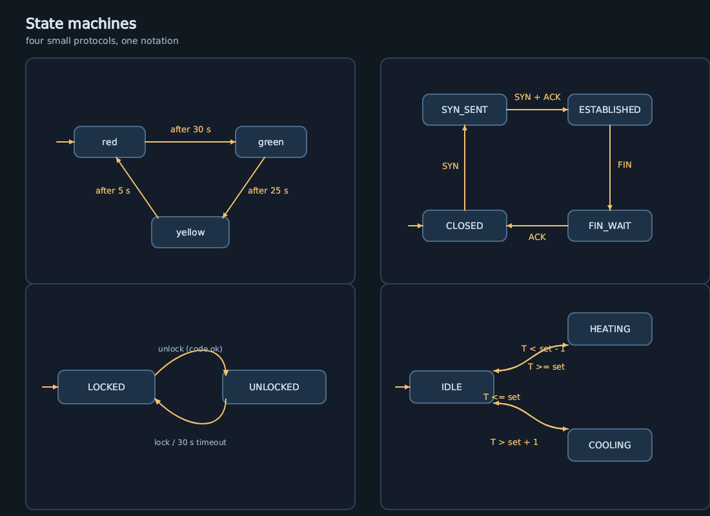 | 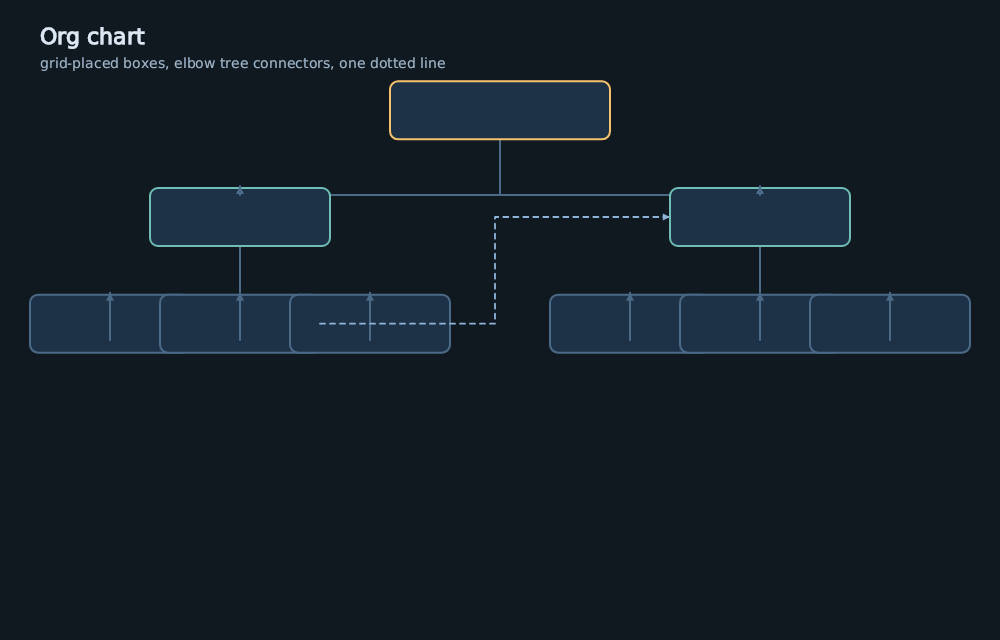 | 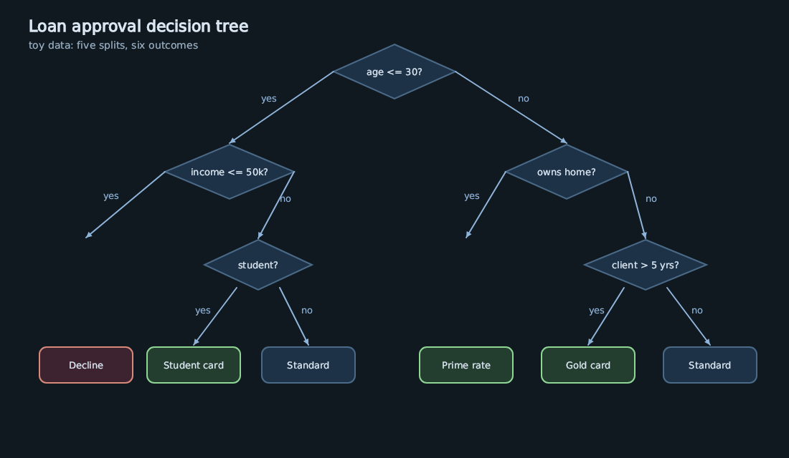 |
| Four small protocols, one notation. [PNG](docs/images/state-machines.png)<br>`lmctl autorun https://raw.githubusercontent.com/lmctl-ai/lmvideo/main/examples/state-machines.lms` | Grid-placed boxes, elbow tree connectors, one dotted line. [PNG](docs/images/org-chart-grid.png)<br>`lmctl autorun https://raw.githubusercontent.com/lmctl-ai/lmvideo/main/examples/org-chart-grid.lms` | Toy data: five splits, six outcomes. [PNG](docs/images/decision-tree.png)<br>`lmctl autorun https://raw.githubusercontent.com/lmctl-ai/lmvideo/main/examples/decision-tree.lms` |

| **Checkout swimlane** | **Release-plan Gantt** | |
| --- | --- | --- |
| 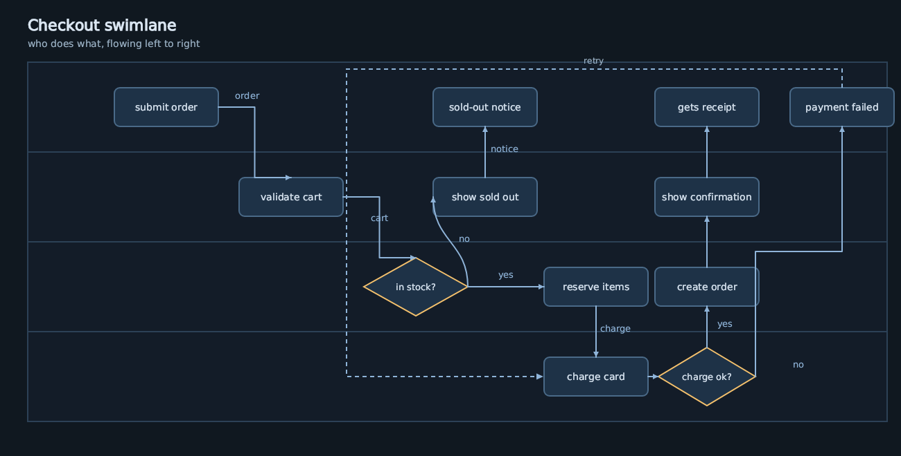 | 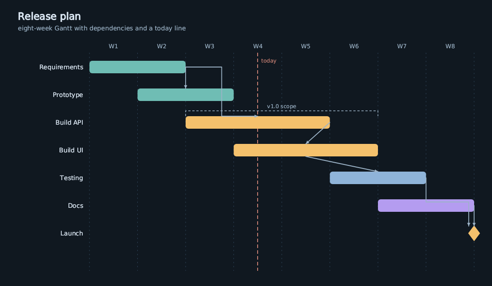 | |
| Who does what, flowing left to right. [PNG](docs/images/swimlane-process.png)<br>`lmctl autorun https://raw.githubusercontent.com/lmctl-ai/lmvideo/main/examples/swimlane-process.lms` | Eight-week Gantt with dependencies and a today line. [PNG](docs/images/timeline-gantt.png)<br>`lmctl autorun https://raw.githubusercontent.com/lmctl-ai/lmvideo/main/examples/timeline-gantt.lms` | |

| **ETL edges draw themselves** | **Sequence reveals message by message** | **Traffic light cycle** |
| --- | --- | --- |
| 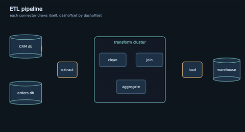 | 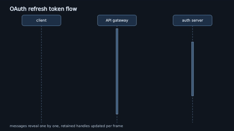 | 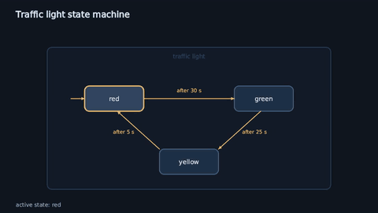 |
| Each connector draws itself with a stroke-dashoffset sweep. [MP4](docs/videos/etl-pipeline-draw.mp4), [PNG](docs/images/etl-pipeline-draw.png)<br>`lmctl autorun https://raw.githubusercontent.com/lmctl-ai/lmvideo/main/examples/etl-pipeline-draw.lms` | Retained message groups flip from hidden to visible in order. [MP4](docs/videos/sequence-messages-reveal.mp4), [PNG](docs/images/sequence-messages-reveal.png)<br>`lmctl autorun https://raw.githubusercontent.com/lmctl-ai/lmvideo/main/examples/sequence-messages-reveal.lms` | The active state's fill and stroke update per frame. [MP4](docs/videos/state-machine-traffic-light.mp4), [PNG](docs/images/state-machine-traffic-light.png)<br>`lmctl autorun https://raw.githubusercontent.com/lmctl-ai/lmvideo/main/examples/state-machine-traffic-light.lms` |

| **Flowchart path trace** | | |
| --- | --- | --- |
| 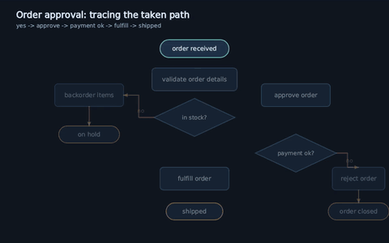 | | |
| The taken yes-branch lights up node by node. [MP4](docs/videos/flowchart-path-trace.mp4), [PNG](docs/images/flowchart-path-trace.png)<br>`lmctl autorun https://raw.githubusercontent.com/lmctl-ai/lmvideo/main/examples/flowchart-path-trace.lms` | | |

**Same diagram vocabulary rendered by lmdraw and lmvideo:**

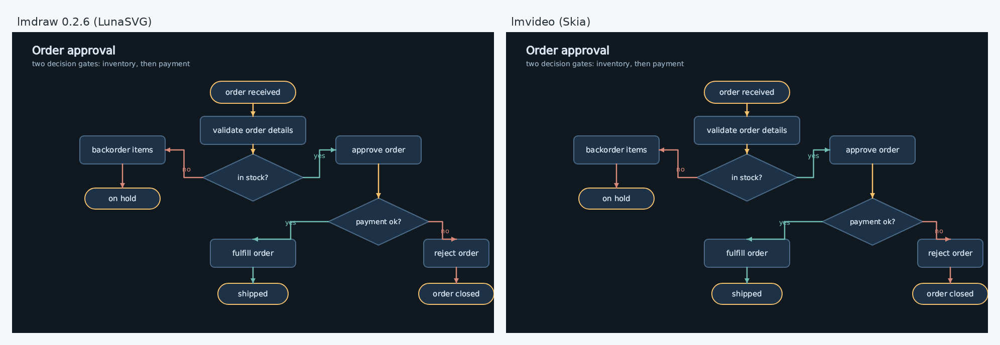

Both hosts draw the same script vocabulary — labeled shapes, named anchors, routed connectors — from one port of `examples/flowchart-order-approval.lms`. `lmctl autorun https://raw.githubusercontent.com/lmctl-ai/lmdraw/main/examples/flowchart-order-approval.lms` · `lmctl autorun https://raw.githubusercontent.com/lmctl-ai/lmvideo/main/examples/flowchart-order-approval.lms`

**Same confusion-matrix input rendered with gnuplot and Skia:**

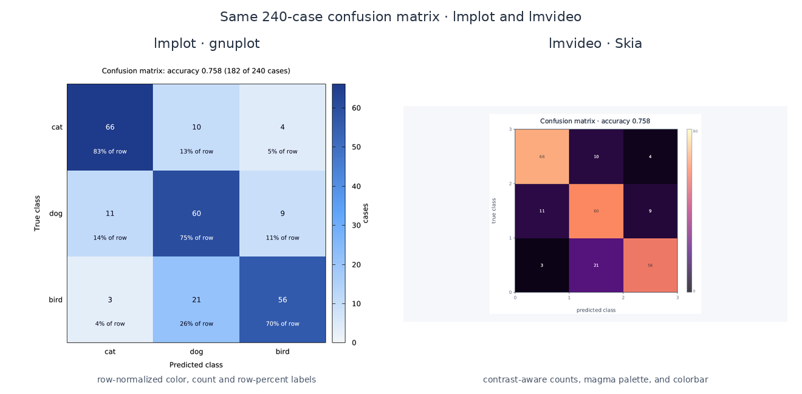

`lmctl autorun https://raw.githubusercontent.com/lmctl-ai/lmplot/main/examples/confusion_matrix.lms` · `lmctl autorun https://raw.githubusercontent.com/lmctl-ai/lmvideo/main/examples/confusion-matrix.lms`

| **One recorded chart, multiple outputs** |
| --- |
| 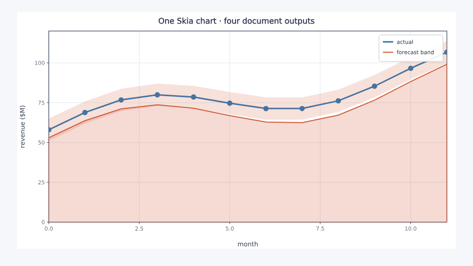 |
| Same Canvas recording written as [PNG 1×](docs/images/vector-outputs.png), [PNG 2×](docs/images/vector-outputs-2x.png), [PNG 3×](docs/images/vector-outputs-3x.png), [SVG](docs/vectors/vector-outputs.svg), [PDF](docs/vectors/vector-outputs.pdf), and [SKP](docs/vectors/vector-outputs.skp). The [SVG-loader round trip](docs/images/vector-roundtrip.png) is pixel-identical to the direct PNG. [Two-page PDF](docs/vectors/vector-report.pdf) uses a chart page and a Panel dashboard page.<br>`lmctl autorun https://raw.githubusercontent.com/lmctl-ai/lmvideo/main/examples/vector-outputs.lms` |


| **Terminal screenshot** |
| --- |
| 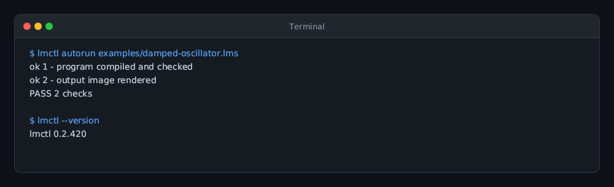 |
| Dark-window terminal screenshot rendered from captured text. Fixed 1000 px width, title bar dots, automatic line wrapping, up to 40 lines, and command highlighting.<br>`lmscript examples/terminal-shot.lms examples/terminal-shot.txt docs/images/terminal-shot.png "Terminal"` |

## Build from source

```sh
npm install -g @lmctl-ai/lmctl
scripts/fetch-skia.sh
nice make                      # build/lmvideo (STATIC=1 links a fully static Linux executable)
nice bash test.sh              # builds in a temp dir and runs 36+ checks
build/lmvideo demo build/demo.png
build/lmvideo render tests/golden/scene.svg build/scene.png
```

`build/lmvideo` is one executable: the DSL host (`--dsl FILE.dslb`, `--dsl-schema [--json]`, `--dsl-signatures`, `--version`) and the two library demos (`demo`, `render`). The test script resolves `lmscript` from `PATH`, checks the version, builds in a temporary directory, checks the library and encoder, renders the SVG and image examples, validates the schema signatures, and runs the video and template examples. It does not install packages or modify system directories.

Each example compiles and runs with no arguments (it uses the `lmvideo` on `PATH`, else the released one); with arguments it only compiles, and you run the bytecode yourself:

```sh
PATH=$PWD/build:$PATH lmscript examples/image.lms                       # compile + run, writes images/image.png
lmscript examples/video.lms build/video.dslb build/video.mp4 60 30       # compile only
build/lmvideo --dsl build/video.dslb
```

The template example iterates a host-owned collection through `len()` and `at()`, interpolates keyframes in DSL loops, and produces both MP4 and PNG output. The runtime reports output paths, frame counts, bytecode size, dispatch count, and wall time in its JSON result line.

## Public interfaces

- `cpp/lmvideo.hpp` is the Skia-free C++ value API.
- `cpp/encoder.hpp` pipes RGBA frames to the external FFmpeg executable.
- `cpp/host.cpp` implements the schema in `schema/lmvideo.dsl.json`; `cpp/main.cpp` dispatches between the host and the `demo`/`render` commands.
- `examples/` contains image, video, SVG, terminal-shot, template-keyframe, animated plot, and explicit layout compositions.
- `Canvas.plot()` creates a retained `Plot`; typed `Series` objects add line, scatter, bar, step, area, and error-bar data. See [durable-memory/07-plot-proposal.md](durable-memory/07-plot-proposal.md) for the schema and behavior.
- `Canvas.panel()` creates a `Panel` with an explicit layout manager; `LayoutItem` carries each child's pack/grid/border/place constraints. See [durable-memory/08-layout-managers.md](durable-memory/08-layout-managers.md) for the schema and behavior.
- `Canvas.box()` / `diamond()` / `cylinder()` / `note()` / `cluster()` create labeled diagram shapes with named anchors; `Canvas.connector()` draws routed edges between points or shape anchors; `Canvas.grid()` returns anchor-cell shapes; `lifeline()` / `message()` / `activation()` / `self_message()` draw sequence notation. `Canvas.draw_diagram()` redraws the retained diagram layer (creation order) on the current frame; shapes compose with `Panel` layouts and every `set_attr` update lands on the next frame. See [durable-memory/11-diagram-vocabulary.md](durable-memory/11-diagram-vocabulary.md) for the schema, resolution order, and the deltas vs lmdraw.
- `scripts/fetch-skia.sh` and `scripts/skia.lock` pin the external Skia archive.
- `assets/fonts/` contains the embedded DejaVu Sans font and its complete license file.

The host schema uses schema 2 signatures, overload-ready imports, enum values, and `returns: "self"` for fluent Paint and Path setters. Common numeric functions are provided by the lmscript runtime; lmvideo keeps only the colour-specific `mix` helper.

lmvideo has no lmapi dependency. Its public contract is the C++ API, the JSON schema, and the lmscript bytecode host described above.

## Relationship to lmscript and the runtime

lmscript compiles the `_dsl_` source into the bytecode consumed by `lmvideo`. lmvideo does not include the compiler. The C++ DSL runtime header is synchronized by [scripts/sync-sdk.sh](scripts/sync-sdk.sh) and pinned by [sdk.lock](sdk.lock); refresh that pin only when the runtime dependency is intentionally updated.

The SDK deliberately leaves host policy in lmvideo: image dimensions, frame counts, encoder settings, file access, and FFmpeg failures are validated by the host. The bytecode runtime supplies loading, verification, and execution and does not add host-specific limits.

## License and provenance

Read [LICENSE](LICENSE) for lmvideo's MIT terms and [THIRD_PARTY_NOTICES.md](THIRD_PARTY_NOTICES.md) before redistributing a binary. The Skia archive is a build input rather than a tracked asset; the notice file records the exact pinned release, the license files present in the archive, and the additional notices still required for binary redistribution. FFmpeg is executed as a separate user-provided process, so its enabled codecs determine the user's FFmpeg obligations.

The compiler comes from [@lmctl-ai/lmctl](https://www.npmjs.com/package/@lmctl-ai/lmctl); the shared interpreter is [lmcode-cpp](https://github.com/lmctl-ai/lmcode-cpp). For CLI-as-server APIs rather than embedded library callbacks, see [lmapi](https://github.com/lmctl-ai/lmapi), [lmrust](https://github.com/lmctl-ai/lmrust), and [lmcpp](https://github.com/lmctl-ai/lmcpp).
